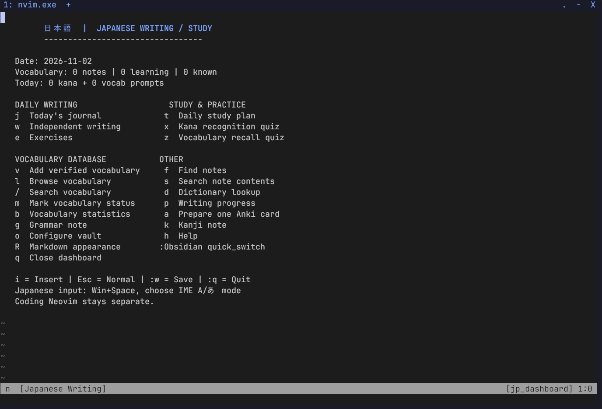
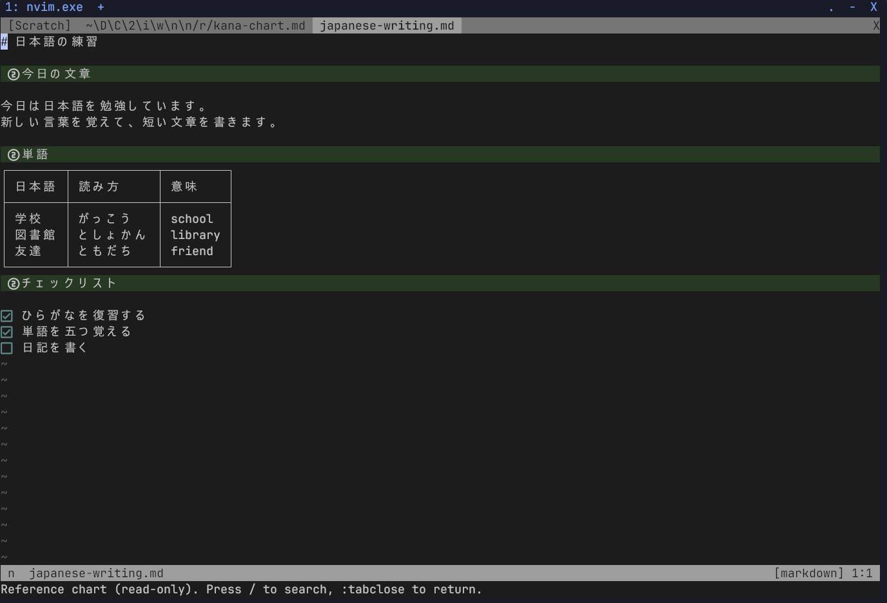

# Neovim profiles on Windows

The repository contains the coding configuration in `nvim/` and a separate
Japanese writing and study configuration in `nvim-jp/`. Both use Neovim 0.12+
with their pinned plugins. A separate process selects each profile; close
Neovim with `:qa` before switching. The coding profile keeps the companion
WezTerm wallpaper and dashboard integration.

## Japanese profile preview

| Study dashboard | Writing page |
| --- | --- |
| [](../docs/screenshots/japanese_dashboard.png) | [](../docs/screenshots/japanese_writing.png) |

The [screenshot gallery](../docs/screenshots/README.md#japanese-writing-profile) also shows the kana and kanji references.

## Install the Japanese profile

Install the coding configuration using the [main README](../README.md).
Then close Neovim and run this from the repository folder in PowerShell.
It asks Neovim for the Japanese profile's actual configuration directory,
including `XDG_CONFIG_HOME`, and backs up an existing installation.
Plugin caches and personal study history are downloaded or created locally.

```powershell
$previousApp = [Environment]::GetEnvironmentVariable('NVIM_APPNAME', 'Process')
try {
    $env:NVIM_APPNAME = 'nvim-jp'
    $jpDir = (& nvim.exe --headless -u NONE -i NONE -n --cmd 'lua io.write(vim.fn.stdpath("config"))' +qa).Trim()
    if ($LASTEXITCODE -ne 0 -or -not $jpDir) { throw 'Could not find the Japanese config directory.' }
} finally {
    if ($null -eq $previousApp) { Remove-Item Env:NVIM_APPNAME -ErrorAction SilentlyContinue }
    else { $env:NVIM_APPNAME = $previousApp }
}
$stamp = Get-Date -Format 'yyyyMMdd-HHmmss'
if (Test-Path -LiteralPath $jpDir) {
    Move-Item -LiteralPath $jpDir -Destination "$jpDir.backup-$stamp" -ErrorAction Stop
    Write-Host "Japanese profile backup: $jpDir.backup-$stamp"
}
New-Item -ItemType Directory -Path (Split-Path -Parent $jpDir) -Force -ErrorAction Stop | Out-Null
Copy-Item -LiteralPath '.\nvim-jp' -Destination $jpDir -Recurse -ErrorAction Stop

# Keep the launcher beside your PowerShell profile.
$launcherDir = Join-Path (Split-Path -Parent $PROFILE) 'NeovimProfiles'
New-Item -ItemType Directory -Path $launcherDir -Force -ErrorAction Stop | Out-Null
$launcherFile = Join-Path $launcherDir 'NvimProfiles.ps1'
if (Test-Path -LiteralPath $launcherFile) {
    Copy-Item -LiteralPath $launcherFile -Destination "$launcherFile.backup-$stamp" -ErrorAction Stop
}
Copy-Item -LiteralPath '.\NeovimProfiles\NvimProfiles.ps1' -Destination $launcherFile -ErrorAction Stop
. $launcherFile
```

If updating an existing Japanese installation, copy its `jp-settings.json`
from the timestamped backup into the new profile to keep the verified vault
and Anki mapping, or run `:JPSetup` again. The example JSON has empty paths;
no personal settings are included in this repository.

For future PowerShell sessions, add this line once to your existing `$PROFILE`:

```powershell
. (Join-Path (Split-Path -Parent $PROFILE) 'NeovimProfiles\NvimProfiles.ps1')
```

## Launch a profile

| PowerShell command | Behavior |
| --- | --- |
| `nvim` | Show Coding/Japanese menu in an interactive terminal with no arguments |
| `nvim-code` | Start the default coding profile |
| `nvim-jp` | Start `NVIM_APPNAME=nvim-jp` |
| `nvim file.lua` / `nvim --headless ...` | Use coding directly, without a menu |
| `nvim.exe` | Run the executable directly, bypassing the launcher |

The launcher temporarily sets or clears `NVIM_APPNAME` and restores its previous
process value when Neovim exits. Coding always means the default `nvim` profile.
Japanese plugins, parsers, undo files, and study logs use separate Neovim data
directories, normally `$env:LOCALAPPDATA\nvim-jp-data`. This directory is not
part of the shared configuration.

## First Japanese session

Run `nvim-jp`, wait for its optional plugins, and run `:Lazy restore` to use the
bundled lockfile. Run `:JPSetup`, select an existing Obsidian vault containing
`.obsidian`, and confirm the Japanese folder. The command saves a local,
Git-ignored `jp-settings.json`. Reopen the profile after setup to enable the
Obsidian integration. Its vault is configured separately from `OBSIDIAN_VAULT`
in the coding profile.

Use `:JPToday` for today's journal, `:JPVocabAdd` for vocabulary, and `:JPHelp`
for the full command and shortcut reference. Use Windows Japanese IME
(`Win+Space`), then select Hiragana mode (あ) in the IME menu to type Japanese.
`:JPMarkdownParsers` installs Markdown, inline Markdown, YAML, and HTML parsers;
it needs Tree-sitter CLI 0.26.1+, `curl`,
`tar`, and a C compiler. The basic writing commands still work if optional
plugins cannot be downloaded.

Dictionary queries open a browser on request. Optional Anki commands require
Anki, AnkiConnect on `127.0.0.1:8765`, and `curl`; each new card is reviewed and
confirmed in the profile. Quizzes are self-rated, and automatic Romaji uses
only the Kana reading you enter. See [Japanese help](../nvim-jp/JP-HELP.md) and
[Markdown setup](../nvim-jp/docs/MARKDOWN-OBSIDIAN.md).

The installation guide, in-editor help, and study templates are currently in English.
See the [complete practice example](../nvim-jp/JP-HELP.md#a-complete-practice-example)
for creating a prompt, writing an answer, and using the stage references.
