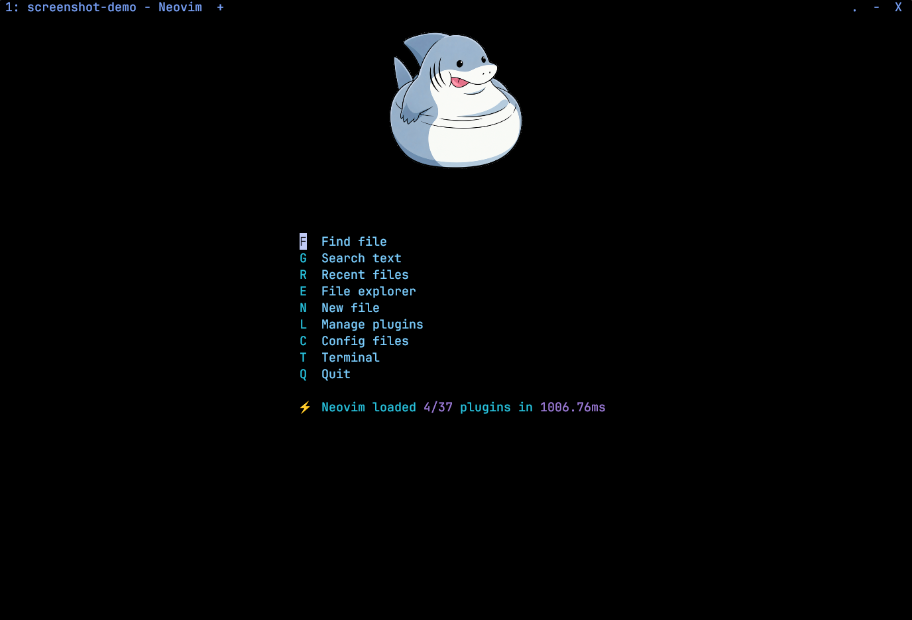
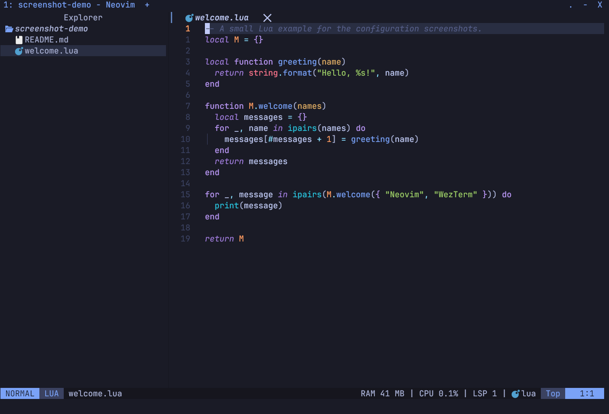

# Neovim- und WezTerm-Konfiguration für Windows

**Sprachen:** [English](README.md) | [Français](README.fr.md) | Deutsch | [日本語](README.ja.md)

Eine Windows-Konfiguration für Neovim, PowerShell und WezTerm mit
Dateiexplorer, Vervollständigung, Sprachservern, Git-Werkzeugen und Python-Debugging.

Optionale Werkzeuge ergänzen Cloud-Entwicklung, KI-Terminalsitzungen,
Markdown und Obsidian, japanisches Schreiben, Bildvorschauen und Hintergrundbilder.
Die vollständige Referenz steht im [Windows-Benutzerhandbuch](MANUAL.de.md).

**Direktzugriff:** [Installation unter Windows](#installation-unter-windows) · [Erste erfolgreiche Sitzung](#erste-erfolgreiche-sitzung) · [Aktualisieren und Wiederherstellen](MANUAL.de.md#aktualisieren-und-wiederherstellen) · [Nützliche Tastenkürzel](#nützliche-tastenkürzel) · [Optionale Funktionen](#optionale-funktionen) · [Dateien und Weitergabe](#dateien-und-weitergabe)

## Screenshots

| Start-Dashboard | Editor und Dateiexplorer |
| --- | --- |
| [](docs/screenshots/dashboard.png) | [](docs/screenshots/editor-explorer.png) |

Die [Funktionsgalerie](docs/screenshots/README.de.md) zeigt alle 31 Screenshots, darunter den Hintergrundbildmanager und das japanische Schreibprofil.

## Voraussetzungen

- [Neovim](https://github.com/neovim/neovim/releases) **0.12 oder neuer**.
- [Git für Windows](https://git-scm.com/downloads/win), [fzf](https://github.com/junegunn/fzf) und [ripgrep](https://github.com/BurntSushi/ripgrep), verfügbar in `PATH`.
- [WezTerm](https://wezterm.org/installation.html) für Terminalhintergründe und die `Ctrl+Tab`-Integration; Neovim funktioniert auch ohne diese Terminalfunktionen.
- PowerShell 7 ist die bevorzugte Shell. Windows PowerShell wird ebenfalls für Editor Services und die CPU-Statusanzeige unterstützt.
- Für Syntaxparser: Tree-sitter CLI **0.26.1 oder neuer**, `curl`, `tar` und ein C-Compiler in `PATH`, etwa MSVC in einer Developer-PowerShell-Sitzung oder Clang. Dies entspricht den [Anforderungen der festgelegten Tree-sitter-Version](https://github.com/nvim-treesitter/nvim-treesitter/blob/a2f694478be07f89c2d03cc17858a8745a400c4b/README.md).
- Python, Node.js/npm und ein JDK nach Bedarf für die im Handbuch beschriebenen Sprachwerkzeuge. Eine Nerd Font ist optional, um Symbole darzustellen.

## Installation unter Windows

Lade dieses Repository herunter oder klone es in PowerShell:

```powershell
git clone https://github.com/Sinthwo/nvim-config.git
Set-Location -LiteralPath '.\nvim-config'
```

Schließe Neovim, öffne PowerShell im Repositoryordner und führe die folgenden Befehle aus. Eine vorhandene Konfiguration wird vor dem Kopieren der neuen Dateien in eine Sicherung mit Zeitstempel verschoben. Installierte Plugindaten bleiben erhalten.

Bei Fehlern in Dateioperationen werden die Befehle abgebrochen. Bewahre den ausgegebenen Sicherungspfad auf.
Lies bei einer vorhandenen Installation zuerst [Aktualisieren und Wiederherstellen](MANUAL.de.md#aktualisieren-und-wiederherstellen),
um lokale Einstellungen zu übernehmen.

```powershell
# Ask the executable directly, bypassing any PowerShell profile launcher.
$nvimDir = (& nvim.exe --headless -u NONE -i NONE -n --cmd 'lua io.write(vim.fn.stdpath("config"))' +qa).Trim()
if ($LASTEXITCODE -ne 0 -or -not $nvimDir) { throw 'Could not find the Neovim config directory.' }
$stamp = Get-Date -Format 'yyyyMMdd-HHmmss'
$nvimBackup = "$nvimDir.backup-$stamp"
if (Test-Path -LiteralPath $nvimDir) {
    Move-Item -LiteralPath $nvimDir -Destination $nvimBackup -ErrorAction Stop
    Write-Host "Neovim backup: $nvimBackup"
}
New-Item -ItemType Directory -Path (Split-Path -Parent $nvimDir) -Force -ErrorAction Stop | Out-Null
Copy-Item -LiteralPath '.\nvim' -Destination $nvimDir -Recurse -ErrorAction Stop
```

### Optional: WezTerm-Konfiguration

Führe diesen separaten Block nur aus, wenn du deine WezTerm-Konfiguration ersetzen möchtest.
Die vorhandene Datei wird zuerst gesichert.

```powershell
$stamp = Get-Date -Format 'yyyyMMdd-HHmmss'
$weztermFile = Join-Path $HOME '.wezterm.lua'
if (Test-Path -LiteralPath $weztermFile) {
    $weztermBackup = "$weztermFile.backup-$stamp"
    Move-Item -LiteralPath $weztermFile -Destination $weztermBackup -ErrorAction Stop
    Write-Host "WezTerm backup: $weztermBackup"
}
Copy-Item -LiteralPath '.\WezTerminal-Config\.wezterm.lua' -Destination $weztermFile -ErrorAction Stop
```

Neovim verwendet normalerweise `$env:LOCALAPPDATA\nvim`. WezTerm liest `$HOME\.wezterm.lua`. Starte WezTerm neu, führe `nvim` aus und warte auf den Abschluss der ersten Plugin- und Werkzeugdownloads. Öffne eine Quelldatei, um die Sprachserverinstallation auszulösen. Starte Neovim nach der ersten Installation neu und führe `:checkhealth` und `:Mason` aus.

## Erste erfolgreiche Sitzung

Öffne WezTerm in einem Git-Übungsprojekt und starte `nvim README.md`. Warte auf
die ersten Downloads, starte Neovim neu und kehre zum Projekt zurück. Verwende
für die Kürzel den Normalmodus (`Esc`); drücke Space-Sequenzen Taste für Taste.

| Ausprobieren | Erwartetes Ergebnis |
| --- | --- |
| `Space f f`, einen Teil des Dateinamens und dann `Enter` drücken | Die Dateiauswahl öffnet die gewählte Datei. |
| Mit `Space f g` nach vorhandenem Text suchen | Treffer erscheinen mit Vorschau; `Esc` schließt die Auswahl. |
| Mit `i` etwas ändern, dann `Esc` und `Ctrl+S` drücken | Die Datei wird gespeichert; die Änderungsmarkierung verschwindet. |
| Eine Lua-Datei öffnen und `Space c f` drücken | StyLua formatiert sie, sobald die Mason-Installation abgeschlossen ist. |
| `Space g g` drücken | Neogit zeigt geänderte Projektdateien; `:close` führt zurück. |

Verwende zum Bearbeiten und Formatieren eine Übungsdatei. Bei Problemen prüfe
`:messages`, `:Mason` und `:ConformInfo`, dann die [Fehlerbehebung](MANUAL.de.md#fehlerbehebung).
Das [Handbuch](MANUAL.de.md) erklärt die weiteren Befehle.

## Nützliche Tastenkürzel

Die Leader-Taste ist **Leertaste**. Drücke die aufgeführten Tasten nacheinander; zum Beispiel öffnet `Space f f` die Dateiauswahl. Drücke die Leertaste und warte auf die Which-Key-Hilfe.

| Tasten | Aktion |
| --- | --- |
| `Ctrl+S` | Aktuelle Datei speichern |
| `Ctrl+B` | Dateiexplorer ein- oder ausblenden |
| `Ctrl+P` / `Space f f` | Datei suchen |
| `Space f g` | Text im Projekt suchen |
| `Ctrl+Tab` / `Ctrl+Shift+Tab` | Nächste / vorherige Datei in WezTerm |
| `Space b c` | Aktuelle Datei schließen |
| `Space c f` | Aktuelle Datei formatieren |
| `Space g g` | Git-Status öffnen |
| `Space u b` | Terminalhintergrund auswählen |
| `Space t t` | Projektterminal ein- oder ausblenden |
| `Space c v` | CSV/TSV-Tabellenansicht umschalten |
| `Space z t` | Azure-Projektterminal öffnen |

Mit `:Codex 8` oder `:Claude 8` öffnest du acht unabhängige CLI-Sitzungen in einem eigenen Neovim-Tab. Beim Öffnen eines Bildes oder PDFs entsteht ein separater WezTerm-Vorschautab. Installiere die erforderlichen externen Werkzeuge vor der Verwendung dieser Funktionen; siehe [Handbuch](MANUAL.de.md#arbeitsbereiche-für-ki-sitzungen) und [Cloud-Einrichtungsanleitung](nvim/SETUP-CLOUD-TOOLS.de.md).

## Optionale Funktionen

Prüfe Änderungen mit `:CodeDiff` oder `:MiniDiffOverlay`, schalte Dateinamen
in Splits mit `:InclineToggle` um und öffne mit `:Oil` einen bearbeitbaren Ordner.
Mit `:AICopyPath` oder `:AICopyContext` kopierst du Codereferenzen für KI-Werkzeuge.
Web- und Markdown-Dateien werden mit prettierd oder prettier formatiert, sofern verfügbar.
Weitere Hinweise stehen in den [Upgrade-Notizen (Englisch)](nvim/UPGRADE_NOTES.md).

`Space u b` öffnet den Wallpaper Manager mit Ordnern, Favoriten, Zufallsauswahl
und Startmodi. Standardmäßig wechselt das Bild beim Start; Manual unter Settings
behält es bei. `Space m p` schaltet die Markdown-/Mermaid-Vorschau im Browser um.

Das optionale Profil `nvim-jp/` ergänzt Japanischschreiben, Vokabeln, Kana/Kanji
und Obsidian. Der PowerShell-Starter bietet bei interaktivem `nvim` ohne Argumente
Coding/Japanese an; `nvim-code` und `nvim-jp` wählen direkt.
Siehe [Profilinstallation (Englisch)](NeovimProfiles/README.md) und
[Handbuch](MANUAL.de.md#japanisches-schreibprofil). Persönliche Profileinstellungen,
Favoriten und Startmodus werden von Git ignoriert.

Das Start-Dashboard bietet Tastenkürzel für Dateien, Suche, Plugins und Terminals.
Die Befehle stehen unter [Dashboard und Benachrichtigungen](MANUAL.de.md#dashboard-und-benachrichtigungen).
Unter [KI-Arbeitsbereiche](MANUAL.de.md#arbeitsbereiche-für-ki-sitzungen) erfährst du,
wie du laufende Sitzungen fokussierst und vergrößerst.

## Dateien und Weitergabe

- `nvim/` enthält die zu installierende Neovim-Konfiguration.
- `WezTerminal-Config/.wezterm.lua` ist die ergänzende Windows-Terminalkonfiguration.
- [MANUAL.de.md](MANUAL.de.md) erklärt alle eingerichteten Funktionen und lokalen Einstellungen.
- `nvim/lazy-lock.json` hält Pluginrevisionen fest; behalte die Datei beim Weitergeben der Konfiguration.

Quellrepository: [Sinthwo/nvim-config](https://github.com/Sinthwo/nvim-config).
Pfade werden für den aktuellen Windows-Benutzer ermittelt; ein fester Benutzername
oder Laufwerksbuchstabe ist nicht erforderlich.

Hintergrundauswahlen verwenden Pfade relativ zum Bildordner. Git ignoriert die Auswahldatei, Protokolle, temporäre Dateien, lokale Umgebungsdateien sowie Terraform-Zustands- und Plandateien. Persönliche Pfade setzt du über lokale Umgebungsvariablen wie `OBSIDIAN_VAULT` und `NVIM_BACKGROUND_DIR`.

Quellen der aktuellen Bilder sind in den [Hintergrundbildnachweisen](nvim/backgrounds/CREDITS.de.md) aufgeführt.

Führe vor dem Weitergeben neuer Änderungen die [Validierungsbefehle](MANUAL.de.md#konfiguration-prüfen) aus und überprüfe deine persönlichen Anpassungen.
