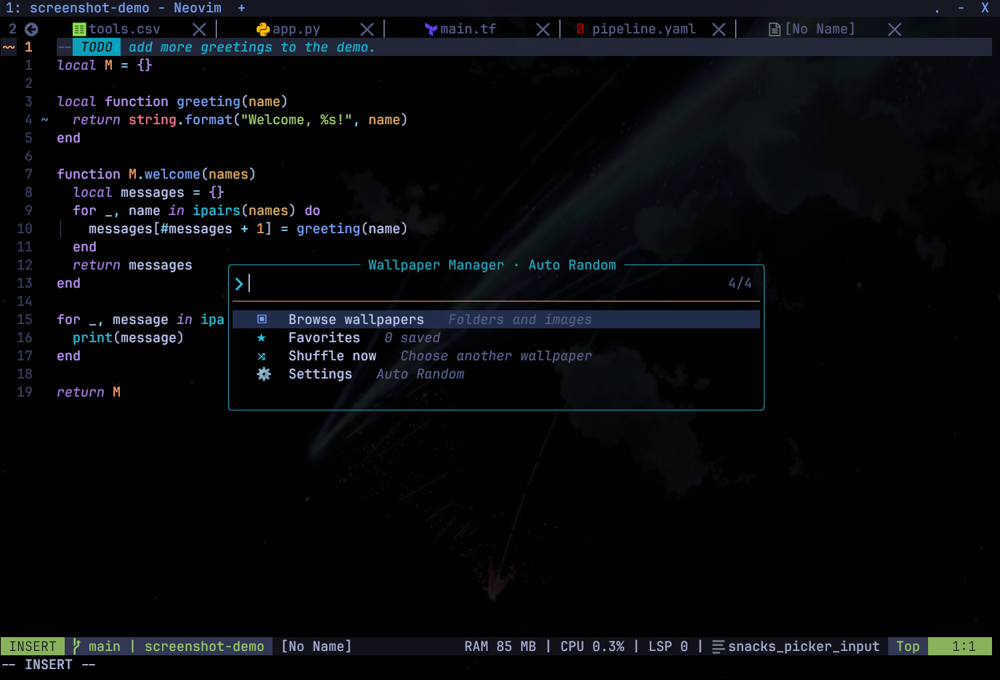

# Hintergrundbilder für Windows

**Sprachen:** [English](README.md) | [Français](README.fr.md) | Deutsch | [日本語](README.ja.md)

Lege deine Hintergrundbilder in diesem Ordner oder dessen Unterordnern ab. Die Auswahl unterstützt PNG, JPG/JPEG, GIF, BMP und WebP. Quellen der enthaltenen Bilder stehen in den [Bildnachweisen](CREDITS.de.md).

Weitere Ansichten der Konfiguration findest du in der [Screenshot-Galerie](../../docs/screenshots/README.de.md).

## Hintergrundbild auswählen

Verwende in Neovim diese Befehle oder Kürzel:

| Befehl | Tasten | Aktion |
| --- | --- | --- |
| `:BackgroundPick` | `Space u b` | Hintergrundbild auswählen |
| `:BackgroundFolder` | `Space u B` | Bildordner im Windows-Explorer öffnen |

`Space u b` öffnet den Wallpaper Manager: Browse wallpapers durchsucht Ordner,
Favorites verwaltet Favoriten, Shuffle now wählt ein anderes Bild, Settings
bestimmt das Startverhalten. Kategorien: `Anime/`, `Games/`, `Real World/`, `Other/`.
Animebilder liegen unter `Anime/<Titel>/Images/`, Animationen unter `GIFs/`.
PNG, JPG/JPEG, GIF, BMP und WebP werden unterstützt, SVG nicht.
Die Oberfläche nutzt Snacks und ersatzweise `vim.ui.select`.

### Startmodi

| Modus | Verhalten |
| --- | --- |
| `random` (Standard) | Bei jedem interaktiven Start ein Bild wählen, möglichst ein anderes als das aktuelle |
| `random_favorite` | Nur Favoriten verwenden; mindestens ein Favorit ist erforderlich |
| `manual` | Die Auswahl behalten; eine manuelle Bildauswahl aktiviert diesen Modus ebenfalls |

Mit `:BackgroundMode random`, `:BackgroundMode random_favorite` oder
`:BackgroundMode manual` setzt du den Modus. Zufallsmodi wählen sofort ein Bild.
Headless-Starts überspringen den Bildwechsel.

| Befehl | Aktion |
| --- | --- |
| `:BackgroundRandom` | Einmal zufällig wählen |
| `:BackgroundFavorite` | Das aktive Bild als Favoriten markieren oder die Markierung entfernen |
| `:BackgroundFavorites` | Favoriten durchsuchen |

Diese drei Befehle behalten den Startmodus bei. Abbrechen verändert weder Bild
noch Modus.

### Lokale Auswahl

`background-mode.txt`, `favorite-backgrounds.txt` und `selected-background.txt`
bleiben lokal und werden von Git ignoriert. Favoriten und Auswahl verwenden
relative Bildpfade wie `Anime/Magi/Images/01-Magi-Friends-under-Starry-Sky.jpg`.
Alte absolute Pfade funktionieren weiterhin und werden beim Schreiben relativ.

## Anderen Bildordner verwenden

Der Standardordner ist Neovims `stdpath("config")` plus `backgrounds`, unter Windows normalerweise `$env:LOCALAPPDATA\nvim\backgrounds`. Setze `NVIM_BACKGROUND_DIR` in Neovim und WezTerm auf denselben absoluten Ordner oder denselben zum Benutzerordner relativen Pfad `~/...`. Starte nach der Änderung beide Anwendungen neu.

## Hintergrundbild in WezTerm anzeigen

Installiere die enthaltene [`WezTerminal-Config/.wezterm.lua`](../../WezTerminal-Config/.wezterm.lua) unter `$HOME\.wezterm.lua`. WezTerm liest die Auswahl und zeigt bei aktivem Neovim ein abgedunkeltes Hintergrundbild. Das Terminalfenster bleibt undurchsichtig; das Bild wird für lesbaren Text gedimmt.

Eine leere Auswahl oder ein fehlendes Bild stellt das normale Terminalaussehen wieder her.

Siehe [Windows-Handbuch](../../MANUAL.de.md#wezterm-und-hintergrundbilder) und [aktuelle Bildquellen](CREDITS.de.md).
